# 🔍 Copy-Move Image Forgery Detection (CMFD)

[](https://www.python.org/)
[](https://opencv.org/)
[](https://scikit-learn.org/)
[](LICENSE)
[]()

> A digital image forensics application designed to detect and localize **Copy-Move Forgery** in digital imagery. The system leverages **Discrete Cosine Transform (DCT)** frequency domain features combined with **Principal Component Analysis (PCA)** dimensionality reduction and spatial distance clustering to uncover duplicated or manipulated regions.

---

## 📌 Problem Overview

Copy-Move Forgery is one of the most common image manipulation techniques, where a portion of an image is copied and pasted into another part of the same image (often to conceal an object, duplicate a feature, or falsify evidence). Because the copied patch comes from the same scene with matching dynamic range, illumination, noise patterns, and color texture, standard edge-detection methods fail.

This project implements an automated, robust feature extraction and matching pipeline capable of identifying duplicated regions even when subjected to minor compression or post-processing.

---

## 🛠️ Methodological Architecture

```mermaid
graph LR
    A[Input Image] --> B[Grayscale Conversion & Grid Tiling]
    B --> C[Overlapping Block Decomposition 16x16]
    C --> D[2D Discrete Cosine Transform: DCT]
    D --> E[PCA Dimensionality Reduction]
    E --> F[Feature Normalization & Lexicographical Sorting]
    F --> G[Euclidean Distance Matching & Thresholding]
    G --> H[Spatial Distance Filtering: False Positive Removal]
    H --> I[Bounding Box Localization & Visual Heatmap]
```



### Detection Pipeline Steps:
1. **Preprocessing & Tiling:** Images are resized and converted to grayscale, then partitioned into overlapping blocks of size $B \times B$ with configurable stride step $S$.
2. **Frequency Feature Extraction (DCT):** 2D Discrete Cosine Transform is applied to each block to extract high-frequency and low-frequency spectral signatures.
3. **Dimensionality Reduction (PCA):** Principal Component Analysis reduces the DCT coefficient matrix to the most informative components, eliminating noise and reducing computational overhead.
4. **Lexicographical Sorting & Similarity Matching:** Feature vectors are lexicographically sorted to place candidate duplicate blocks adjacent to each other. Euclidean distance is computed across neighbors.
5. **Spatial Distance Filtering:** To prevent adjacent blocks in uniform regions (e.g. flat sky or uniform background) from falsely registering as forgeries, a minimum physical Euclidean distance threshold is enforced.
6. **Localization & Highlighting:** Duplicated pairs are mapped back to pixel coordinates and highlighted with bounding boxes.

---

## 📂 Project Structure

```text
Image-forgery-detection-app/
├── copy_move.py           # Full end-to-end CMFD pipeline (lexicographical matching & spatial filtering)
├── feature_extraction.py  # Discrete Cosine Transform (DCT) & PCA feature extractors
├── forgery_detection.py   # Pairwise feature distance calculation and block matching
├── preprocess.py          # Grayscale conversion, normalization, and block partitioning
├── visualization.py       # Cartographic bounding-box visualizer and histogram plotting
├── main.py                # Command-line entry point with configurable thresholds
├── requirements.txt       # Python dependencies
├── samples/               # Benchmark sample images (forged & authentic test cases)
└── results/               # Output annotated images and detection overlays
```

---

## 🚀 Installation & Usage

### 1. Setup Environment
```bash
git clone https://github.com/100kuta/Image-forgery-detection-app.git
cd Image-forgery-detection-app

python -m venv .venv
source .venv/bin/activate  # On Windows: .venv\Scripts\activate

pip install -r requirements.txt
```

### 2. Run Detection (CLI)
Run detection on default sample image:
```bash
python main.py --image samples/beach_wood_copy.jpg --block-size 16
```

Run with interactive graphical display:
```bash
python main.py --image samples/beach_wood_copy.jpg --gui
```


Execute the full overlapping block pipeline:
```bash
python copy_move.py
```

Annotated output results are automatically saved in the `results/` directory.

---

## ⚙️ Key Hyperparameters

| Parameter | Default | Description |
|---|---|---|
| `BLOCK_SIZE` | `16` | Dimension of square blocks ($16 \times 16$ pixels) |
| `STEP` | `8` | Stride step for overlapping block extraction |
| `PCA_COMPONENTS` | `64` | Retained principal components per block |
| `DUPLICATE_THRESHOLD` | `0.1` | Maximum Euclidean distance for matching features |
| `MIN_DISTANCE` | `20` | Minimum physical pixel separation to discard false positives |

---

## 📜 License & Citation

Licensed under the MIT License. Contributions and issues are welcome!